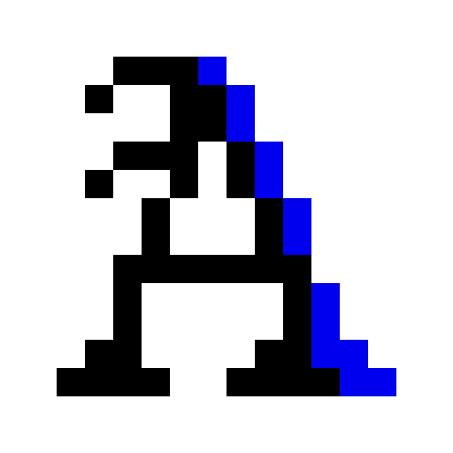
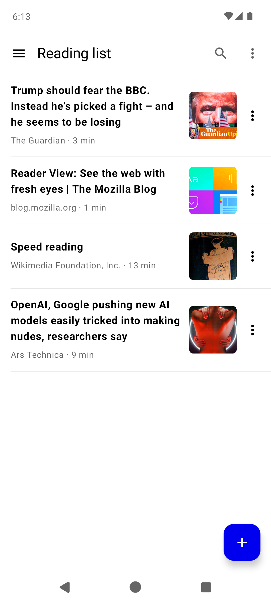
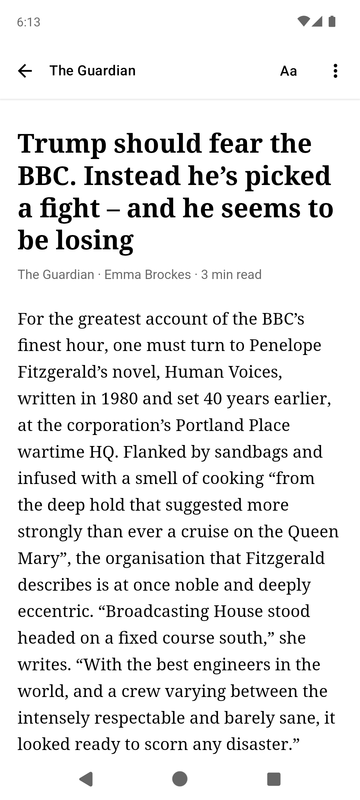
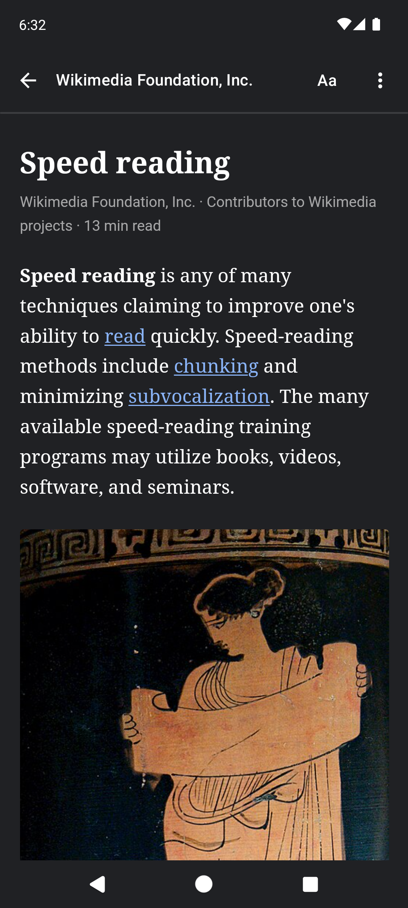

# Reedr

A tiny Android read-it-later app. Share an article to Reedr from any app (a browser, a news app, Reddit & co.) and it opens straight away as a clean, readable page: just the text and its pictures, saved on your phone to read now or later, offline. Keep it in your reading list, archive it when you're done, highlight what matters and search everything you saved, article text included.

It's a much simpler take on [Article Reader – Offline](https://play.google.com/store/apps/details?id=com.olegsheremet.articlereader): written from scratch, with Firefox's Reader View engine for cleaner pages. No accounts, no ads, no analytics, no servers: pages come straight from the site and stay on the phone.

If you like this or find it useful, support the project by buying me a coffee.

<a href="https://www.buymeacoffee.com/antoniocosta" target="_blank"></a>

  

Reedr has two sibling apps with the same look: [IPeekr](https://github.com/antoniocosta/IPeekr), a home-screen widget that shows your connection, and [BLinkr](https://github.com/antoniocosta/BLinkr), a link router for social media.

- **Stack:** Kotlin, Compose, Room, WorkManager, OkHttp, jsoup, Mozilla Readability.
- **SDK levels:** minSdk 26, target 36.
- **Theme:** black, white and blue (#0000EE; #8AB4F8 on #202124 in dark mode). Follows the system's light or dark mode, or pick Light or Dark at the bottom of Settings.

## Features

- **Save:** *Share → Save to Reedr* from a browser or any app, or open an http(s) link with Reedr, or tap + and paste a link. A shared link opens straight in the reader, which fills in as soon as the page is saved (a second or two); Back goes to the reading list. Tracking parameters (`utm_*`, `fbclid`, …) are dropped, so the same article saved twice is one entry; sharing it again just opens it.
- **Lists:** *Reading list* (what you haven't archived), *Archive* and *History*. Archiving from the reading list moves an article to the Archive; archiving from History adds it there and it stays in History, which is simply everything you opened. History can be turned off in Settings (that also clears it). Each list's ⋮ menu has *Delete all* (*Clear history* in History).
- **Search:** the 🔍 in a list filters that list as you type, matching the title, the article text, the site, the author, the excerpt and the URL.
- **Reader:** remembers where you stopped; text size, line spacing, font and page colour (Auto, Light, Sepia, Dark) apply live. Pinching changes the text size smoothly, following your fingers. Links open a small menu: open, save to Reedr, copy. Optionally, reaching the end archives the article.
- **Highlights:** select text and tap *Highlight*. Tap a highlight to copy, share or remove it; the article's ⋮ menu lists them and jumps to each.
- **Lists can be pinched too**, to make their text bigger or smaller.

## How it works

Saving ([`SaveWorker`](app/src/main/java/net/uncorp/reedr/save/SaveWorker.kt), a WorkManager job that waits for a network and retries server errors twice):
1. **Download** the page once with OkHttp, as a normal Chrome on this phone ([`UserAgent.kt`](app/src/main/java/net/uncorp/reedr/save/UserAgent.kt): the system WebView's own User-Agent without the "WebView" markers, so its Chrome version stays current). jsoup decodes it with the right charset.
2. **Extract the article** with [Mozilla Readability](https://github.com/mozilla/readability), the engine of Firefox's Reader View, run in an off-screen WebView ([`ReadabilityExtractor.kt`](app/src/main/java/net/uncorp/reedr/save/ReadabilityExtractor.kt)). The fast path parses the downloaded HTML with `DOMParser` in an empty page, so none of the site's scripts run and nothing else is downloaded (about 1 s). Pages built by JavaScript come back nearly empty; for those, Reedr loads the live page (images blocked), waits until its text stops growing and extracts again (a few seconds more).
3. **Clean up and store** ([`ArticleCleaner.kt`](app/src/main/java/net/uncorp/reedr/save/ArticleCleaner.kt)): one real URL per image (lazy-loading attributes, `srcset`, `<picture>`), an allowlist sanitizer (no scripts, iframes, styles or event handlers survive), placeholders and tracking pixels dropped. Images are downloaded next to the article, four at a time. The text goes into a full-text index for search.

Reading ([`ReaderWebView.kt`](app/src/main/java/net/uncorp/reedr/ui/reader/ReaderWebView.kt)): the stored copy is shown in a WebView that only serves the app's own files (`WebViewAssetLoader`) and refuses every other request, so reading never touches the network. A small script ([`reader.js`](app/src/main/assets/reader.js)) keeps the reading position and draws the highlights, which are stored as their text plus a little context so they survive a different text size.

## Limits

- **Paywalled and login-only pages** are saved as the site shows them to a visitor without an account, often just the first paragraphs.
- **PDFs and other non-HTML links** can't be saved.
- **Videos, embedded tweets and interactive graphics** are left out of the saved copy.
- **Release builds don't log** (R8 strips `Log.v/d/i/w`).

## Develop

The scripts use the SDK, JDK and emulator from an `android-dev-toolkit` folder next to this repo (override with `TOOLKIT=`). With your own Android SDK and JDK 17+, plain `./gradlew assembleDebug` works too.

```sh
scripts/dev.sh run                     # build, install on emulator-5554, launch
scripts/dev.sh test                    # unit tests
scripts/dev.sh phone                   # release build (R8, ~2 MB) installed on the USB phone, user 0
scripts/dev.sh emu                     # the same release build on the emulator
scripts/dev.sh share https://…         # share a link to Reedr as another app would
```

## Icon

The icon source is `art/reedr.svg` (512px pixel art). `scripts/gen-icon.py` regenerates the launcher drawables from it.

## Credits

[Readability.js](https://github.com/mozilla/readability) (Mozilla, Apache 2.0) is bundled as `app/src/main/assets/readability.js`, version 0.6.0. Also [jsoup](https://jsoup.org) (MIT) and [OkHttp](https://square.github.io/okhttp/) (Apache 2.0). The app lists them under Settings → Open-source licenses.
